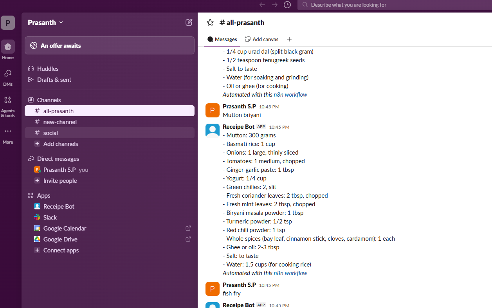
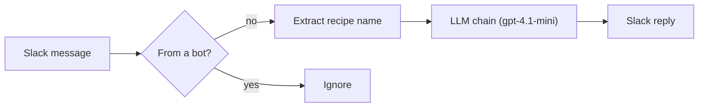

# Slack Recipe Bot (n8n)

> Type a dish name in Slack and get the ingredient list for two people.

  

## Overview

A Slack chatbot built in n8n. When a user posts a recipe name, the workflow filters out bot messages (so it never replies to itself), sends the dish to an LLM chain, and posts a short bulleted ingredient list with quantities back to the channel. Unclear inputs get a polite "please enter a valid recipe name" reply.

## Features

- Slack event trigger
- Loop protection: ignores bot messages
- LLM chain with a focused cooking prompt (`gpt-4.1-mini`)
- Slack-formatted bulleted reply

## Demo



## How it works



## Tech stack

| Layer | Technology |
|---|---|
| Automation | n8n |
| LLM | OpenAI `gpt-4.1-mini` |
| Channel | Slack |

## Project structure

```text
.
├── Slack_Receipe_Bot.json   # n8n workflow export
└── slack_Recipe.png
```

## Getting started

**Prerequisites:** a running [n8n](https://n8n.io) instance (n8n Cloud or self-hosted), a Slack app with event subscriptions

1. Download `Slack_Receipe_Bot.json` from this repository.
2. In n8n, open **Workflows → Import from File** and choose the JSON file.
3. Open each node that needs an account and connect your own credentials (listed below). The export contains no secrets, only credential names.
4. Click **Execute workflow** to test, then **Activate** it.

## Usage

Post a dish name in the connected channel, for example *"Paneer Butter Masala"*.

## Notes

- Credentials to connect: Slack, OpenAI.

## License

Released under the [MIT License](LICENSE).

## Author

**Prasanth Sundararajan**, Senior SRE and AI Engineer  
[LinkedIn](https://www.linkedin.com/in/prasanth-s-a093a7109/) · [GitHub](https://github.com/prasanth-sundararajan)
